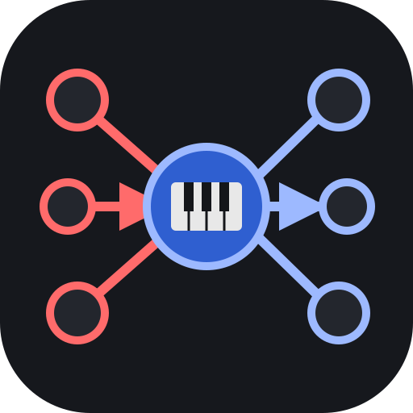

# V7 Secondary Dominant Harmony Map

An interactive map of how a dominant 7th chord connects to its neighbours, with a small piano keyboard on every chord showing which keys to press.

Live: https://creaktive.github.io/V7-chords/

## What it shows

The centre is one dominant 7th chord (C7 when the page opens). Around it:

- **Red chords** lead into the centre. They sit on the left, or across the top on a phone.
- **Grey chords** are the triads the centre can move to. They sit on the right, or across the bottom on a phone. Each is shown as major or minor; the dashed key is the minor third. The one a fifth below, marked `I / i`, is the tonic the centre is the V7 of.
- **Edge labels** give the root motion in semitones, or in whole tones (see below): ⊕ is up, ⊖ is down.
- **Keyboards** cover two octaves from C. The root key has a stronger colour than the other chord tones.

For C7 (root motion in semitones):

| Chord | Role | Root motion |
| --- | --- | --- |
| G7 | secondary dominant of C7 (`sec. dom.`) | ⊖7 into C7 |
| F♯7 | tritone substitute of C7 (`sub.`) | ⊕6 into C7 |
| C♯7 | tritone substitute of the secondary dominant (`sub. of sec. dom.`) | ⊖1 into C7 |
| B / Bm | target | ⊖1 from C7 |
| D / Dm | target | ⊕2 from C7 |
| F / Fm | target, marked `I / i`: the tonic C7 is the V7 of | ⊖7 from C7 |

A tritone substitute is the dominant 7th chord a tritone (6 semitones) away.

## Using it

- Click or tap the centre circle to open a ring of 12 roots, then pick one. Click an empty part of the map, or press Escape, to close it.
- Click or tap a red chord to make it the new centre.
- From the keyboard: Tab to move, Enter or Space to activate, Escape to close the ring.
- The root lives in the URL hash, so a link keeps the chord: `#0` is C, `#2` is D, up to `#11` for B. On load, a missing or invalid hash gives C.
- Notes are spelled with flats when the centre is D♭, E♭, F, A♭ or B♭, and with sharps otherwise. The ring shows both spellings.
- The Spelling button cycles through that automatic choice, all sharps (♯) and all flats (♭). A forced spelling applies to the ring too.
- An underlined name differs from the chord's own spelling, which is its name as the centre in automatic spelling. In automatic spelling it borrows the centre's spelling: next to C7, C♯7 is underlined because as the centre it is D♭7. A forced spelling can underline the centre too: forcing ♯ on B♭7 shows A♯7. The ring is never underlined.
- The Steps button switches the edge labels between semitones and whole tones: ⊖7 becomes ⊖3½.
- Neither button setting is saved in the URL, so a link always opens with automatic spelling and semitones.

## Running it

There is no build and there are no dependencies. Open `index.html` in a browser, or serve the folder with any static server.

Every push to `main` deploys the site to GitHub Pages through `.github/workflows/pages.yml`.

The page needs a reasonably recent browser. The layout switch uses `matchMedia(...).addEventListener`, which means Safari and iOS 14 or later.

## How it is built

| File | What it holds |
| --- | --- |
| `index.html` | The page shell: heading, instructions, the Spelling and Steps buttons, the empty `<svg id="map">`, a footer link. |
| `style.css` | Colours (light and dark), node and keyboard styling, focus ring. |
| `app.js` | All logic. |
| `reference/` | The Mermaid source (`.mmd`) of the first sketch. It labels edges in whole tones and uses Portuguese `do` for "of"; the app defaults to semitones and uses English. |

In `app.js`:

- `draw(root, open, layout, spell, whole)` returns the SVG markup for one state and touches nothing else. `spell` and `whole` hold the two button settings and change only labels. `render()` puts it on the page and, if keyboard focus was inside the map, moves it to the centre. `set(r)` changes the root and updates the URL hash.
- There are two layouts. `WIDE` puts the chords in two side columns and is used from 600px wide up. `TALL` puts them in rows, three across, for phones in portrait (599px or less). It switches when the screen rotates or the window is resized.
- On a phone the role note under a red chord wraps onto its own lines. On the wide layout it shares the chord's line.
- `PianoOctave` and `piano()` draw the keyboards. The geometry comes from http://www.quadibloc.com/other/cnv05.htm.

## Self-check

When the page loads, it draws all 12 roots in both layouts into a detached SVG and reads the result back. It checks the chord names for the D and B♭ maps, that exactly one target is marked I / i and sits a fifth below the centre, and that every keyboard lights exactly the chord its own label names, including the root key and the minor third. It also checks that a forced spelling shows only sharps or only flats, that forced flats reach the ring, that in every spelling mode a name is underlined exactly when it differs from the chord's own spelling, and the whole-tone labels of the D map.

A failure shows only in the browser console as `Assertion failed`. No such line means the check passed.

Known gap: a typo in the `SHARP` or `FLAT` name lists outside the D and B♭ maps is not caught.

## License

MIT. See [LICENSE](LICENSE).
